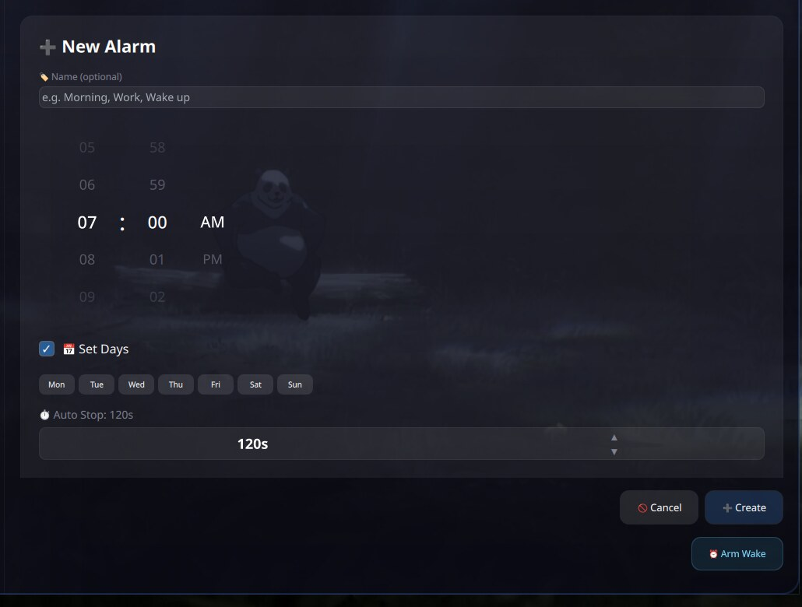
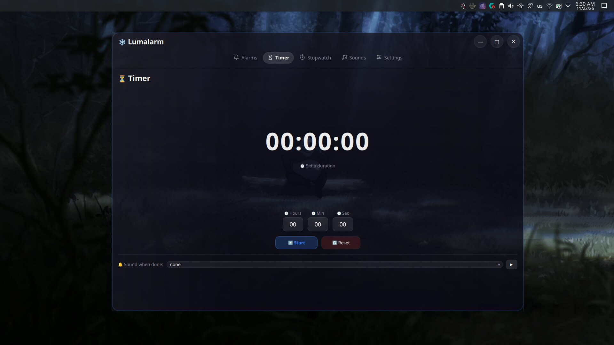
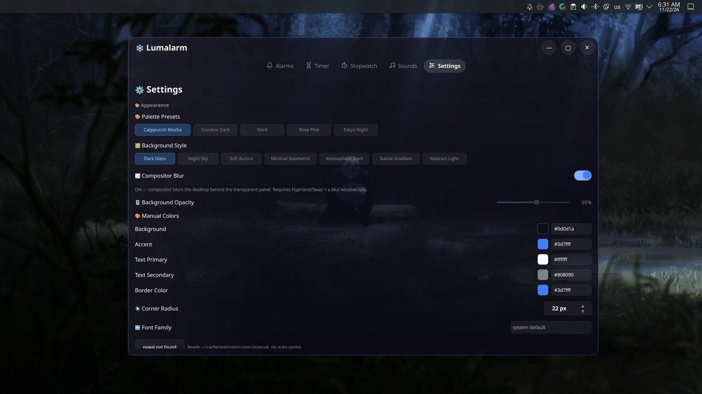

<div align="center">


**Lumalarm** — a smart alarm clock for Linux that wakes your computer from sleep

Suspend-to-RAM wake scheduling · anti-oversleep challenges · timer · stopwatch · sound manager

[](LICENSE)
[](https://www.qt.io/)
[]()

<!-- Badges activate after the first push to main; see RELEASE_DEFERRED.md -->
[](https://github.com/shinigami1231111/lumalarm/actions/workflows/ci.yml)
[](https://github.com/shinigami1231111/lumalarm/actions/workflows/lint.yml)

</div>

---

## Building & Testing

```sh
cmake -B build -DCMAKE_BUILD_TYPE=Release
cmake --build build -j$(nproc)
ctest --test-dir build --output-on-failure
```

The local mirror of CI is `bash scripts/ci-local.sh` (or `make ci`): same Release build
with KDE blur disabled, then ctest, then an advisory clang-tidy pass.

Translations are compiled into the binary automatically when Qt Linguist is installed;
see [CONTRIBUTING.md](CONTRIBUTING.md#translations) for how to add or refresh a language.

See [CONTRIBUTING.md](CONTRIBUTING.md) for prerequisites, the CI matrix, the optional
pre-push hook, and everything else.

---

## The idea

**Lumalarm is an alarm clock that turns your Linux PC into a real alarm clock.**

Most alarm apps assume your computer is already awake. Lumalarm doesn't. Hit **Arm & Suspend** and it puts the machine to sleep (via `rtcwake`), then wakes it back up automatically — right before your alarm fires. No leaving the PC running all night just to hear a beep in the morning.

And once it wakes you, it makes sure you actually **get up**: a typing or math challenge, a "still awake?" check, and escalating prompts keep you honest instead of letting you hit snooze in your sleep.

That suspend-to-wake behavior is the core power of Lumalarm. Everything else — the timer, stopwatch, sound manager, and the clean themable interface — is built on top of it.

---

## Screenshots

**Alarms**




**Timer**



**Stopwatch**


**Sound Manager**


**Settings**



---

## Features

- **Alarms that wake a sleeping PC** — recurring or one-shot, scheduled to wake the machine from suspend via `rtcwake`
- **Anti-oversleep challenges** — typing challenge or math problem to dismiss an alarm
- **"Still awake?" check** — verifies you're up instead of trusting the snooze button
- **Soundscape wake** — ambient track plays quietly 90s before the alarm, ramps in, then crossfades to the main tone
- **Snooze limiting** — set a max number of snoozes per alarm (or disable snooze entirely)
- **Escalating wake** — screen brightness ramp, then sound, then forced challenge if you don't respond
- **Alarm notes** — attach a note ("flight to Istanbul") shown prominently when the alarm fires
- **Countdown timer & stopwatch** — with laps and completion sounds
- **Sound manager** — import and preview your own tones (`wav`, `mp3`, `ogg`, `flac`, `aac`)
- **Volume fade-in & auto-stop** — wakes you up gently instead of blasting you out of bed
- **Custom commands** — run any shell command when an alarm fires
- **Fully themeable** — a built-in color picker for background, accent, and opacity, plus a selectable time-picker style (wheels, dual clocks, single clock)
- **System tray** — a tray icon with the next alarm in its tooltip and Open/Quit actions, toggleable from Settings
- **Desktop notifications** — a heads-up before an alarm is due and a notification when it rings, over the freedesktop notification service (no libnotify)
- **Test alarm** — arm a real wake 60 s to 1 h ahead without creating an alarm, to prove the machine actually wakes
- **Night mode** — dims the window a few minutes before the alarm so it never lights up a dark room
- **First-run setup wizard** — six skippable steps on the very first launch: language, default sound, test alarm, notifications and a summary. Existing installations are never prompted after an upgrade, and `--show-wizard` reopens it any time
- **English & Arabic UI** — pick the language in Settings or during setup; Arabic mirrors the layout to right-to-left

---

## Table of Contents

- [Building & Testing](#building--testing)
- [The idea](#the-idea)
- [Screenshots](#screenshots)
- [Features](#features)
- [Installation](#installation)
  - [Dependencies](#dependencies)
  - [Build from Source](#build-from-source)
  - [AUR](#aur)
- [Configuration](#configuration)
- [Theming](#theming)
- [Wake Setup (D-Bus helper)](#wake-setup-d-bus-helper)
- [Contributing](#contributing)
- [License](#license)

---

## Installation

### Dependencies

- **Qt 6** — Core, Multimedia, Qml, Quick, Declarative
- **CMake** ≥ 3.21
- **C++17** compiler (GCC or Clang)
- **KF6WindowSystem** *(optional but recommended for KDE Plasma users)* — provides KWin blur-behind; package `kwindowsystem` (Arch), `libkf6windowsystem-dev` (Debian/Ubuntu), `kf6-kwindowsystem` (Fedora). If absent, the app still builds/runs without KWin-native blur.
- **Qt 6 Linguist tools** *(optional, `lupdate`/`lrelease`)* — package `qt6-tools` (Arch), `qt6-tools-dev` (Debian/Ubuntu), `qt6-qttools-devel` (Fedora). Only needed to compile or refresh translations; if absent the app still builds and runs, in English.
- **rtcwake** *(optional)* — from `util-linux`, needed for suspend-to-RAM

<details>
<summary><b>Arch Linux</b></summary>

```bash
sudo pacman -S cmake qt6-base qt6-multimedia qt6-declarative kwindowsystem
```
</details>

<details>
<summary><b>Ubuntu / Debian</b></summary>

```bash
sudo apt install cmake build-essential qt6-base-dev qt6-multimedia-dev qt6-declarative-dev libkf6windowsystem-dev
```
</details>

<details>
<summary><b>Fedora</b></summary>

```bash
sudo dnf install cmake qt6-qtbase-devel qt6-qtmultimedia-devel qt6-qtdeclarative-devel kf6-kwindowsystem
```
</details>

### Build from Source

```bash
git clone https://github.com/shinigami1231111/lumalarm.git
cd lumalarm
cmake -B build -DCMAKE_BUILD_TYPE=Release
cmake --build build -j$(nproc)
./build/lumalarm
```

### AUR

```bash
paru -S lumalarm
# or, with yay:
yay -S lumalarm
```

---

## Configuration

All data lives in `~/.config/lumalarm/`:

| Path | Purpose |
|---|---|
| `theme.conf` | **Theme** — colors, blur mode, opacity, font, corner radius (hand-editable, live-reloaded) |
| `settings.ini` | Non-theme app behavior (snooze, fade, wake mode, stopwatch) |
| `alarms.json` | Alarm list (persisted, human-readable) |
| `tones/` | Imported alarm sound files |

---

## Theming

Lumalarm is built for **ricing / tiling-WM users** (Hyprland, Sway, etc.) and uses
**true window-level transparency** — the window surface has a real per-pixel alpha
channel, so a Wayland/X11 compositor can blur the desktop *behind* it. It does **not**
fake transparency with a translucent gray rectangle.

### `theme.conf`

Located at `~/.config/lumalarm/theme.conf` (KDE-style `key=value`, easy to hand-edit
and commit to a dotfiles repo). Editing it **reloads the theme live** — no restart.

| Key | Meaning | Example |
|---|---|---|
| `background_color` | App background (RGB hex) | `#1e1e2e` |
| `accent_color` | Accent / highlight | `#cba6f7` |
| `text_primary` | Primary text | `#cdd6f4` |
| `text_secondary` | Secondary text | `#a6adc8` |
| `border_color` | Window/card border | `#cba6f7` |
| `blur_radius` | (reserved) blur radius hint | `20` |
| `blur_mode` | `compositor` or `app` | `compositor` |
| `card_opacity` | Background alpha 0.0–1.0 (real alpha) | `0.55` |
| `font_family` | Nerd/font family, blank = system | `JetBrains Mono` |
| `corner_radius` | Window corner radius (px) | `18` |

### Built-in palette presets

Selectable from **Settings → Theming**; each writes a complete `theme.conf` you can
then hand-tune:

- **Catppuccin Mocha**
- **Nord**
- **Gruvbox Dark**
- **Rose Pine**
- **Tokyo Night**

### Blur mode

- **Compositor** (default, for Hyprland/Sway): the window stays genuinely transparent
  and the compositor blurs the desktop behind it.

  - **Hyprland / Sway users:** add a window rule so your compositor actually blurs Lumalarm:

    ```ini
    # Hyprland (~/.config/hypr/hyprland.conf)
    windowrulev2 = blur, class:^(lumalarm)$
    ```

    For Sway, blur through a background tool (e.g. `swaybg` + a blur shader, or a fork
    that supports it); Lumalarm simply exposes the transparent surface. This is the
    only step needed on Hyprland — Hyprland's rule-based blur works on the existing
    transparent window with no extra code.

  - **KDE Plasma (KWin) users:** transparent windows are **not** blurred automatically
    by KWin the way they are under Hyprland. Lumalarm additionally requests blur-behind
    via KWindowSystem, but two things are required on your side:
    1. The **KWindowSystem** runtime dependency must be installed (see Dependencies),
       and Lumalarm must have been built with KDE blur support (it is by default when
       the library is present).
    2. The **"Blur" desktop effect must be enabled** in
       *System Settings → Desktop Effects → Blur*. With it off, KWin shows plain
       transparency (no crash, no broken visuals) — that's expected KWin behavior.
    The blur-behind request is re-applied on resize and whenever you switch blur modes.

- **App** (fallback for X11 / GNOME without compositor blur): the panel is drawn
  nearly opaque so there are no transparency artifacts where no compositor blur exists.
  In this mode Lumalarm does **not** request KWin blur-behind at all.

### pywal import

Manual only (no auto-apply on wallpaper change). From **Settings → Theming → Import
from pywal**, if `~/.cache/wal/colors.json` exists Lumalarm maps its roles
(`background`, `foreground`, `color1`/`color4`, `color8`) onto the theme fields.
If the file is absent, the button is disabled and nothing happens.

### Fonts

`font_family` is free-text. If the font isn't installed, Lumalarm silently falls back
to the system default — it never crashes on a missing font.

### Alarm tones

To add tones without the GUI:

```bash
cp my-sound.wav ~/.config/lumalarm/tones/
```

---

## Wake Setup (D-Bus helper)

Install the package; the wake helper is registered automatically via D-Bus.

Wake scheduling runs behind a privilege boundary: the app calls the `org.lumalarm.Helper` system service, which runs as root and invokes `systemd-run --on-active=… --property=WakeSystem=yes` (systemd ≥ 254) or `rtcwake` directly (older systemd). No sudoers rule and no password prompt are involved.

The helper requires **rtcwake** (`util-linux`) or **systemd ≥ 254**.

**Troubleshooting:** if scheduling fails, check the helper log:

```bash
journalctl -u lumalarm-wake-helper
```

**Available suspend modes:**

| Mode | Behavior |
|---|---|
| `mem` | Suspend-to-RAM |
| `disk` | Hibernate |
| `none` | Just set the RTC wake time, don't suspend |

---

## Contributing

Contributions are welcome! Feel free to open an issue or submit a pull request for bug fixes, new features, or theme presets.

---

## License

Licensed under the **GNU General Public License v3.0** — see [LICENSE](LICENSE) for details.
