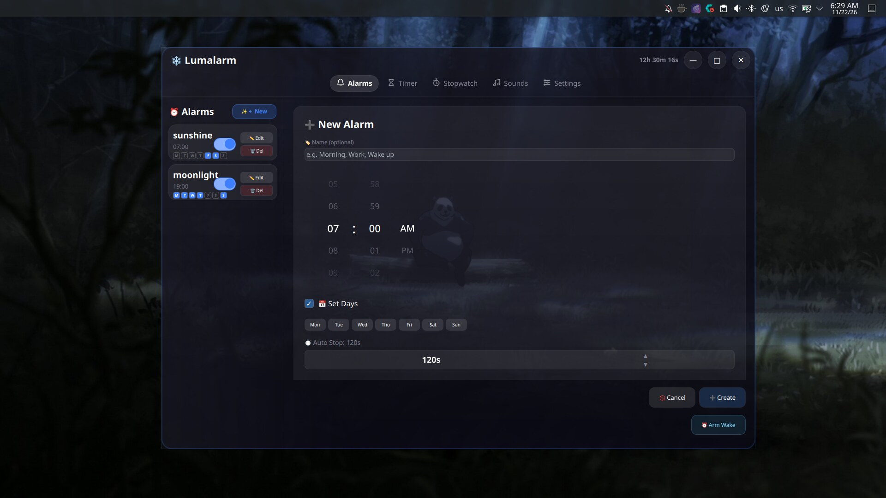
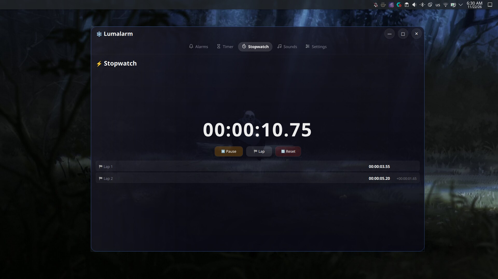

<div align="center">


**Lumalarm** — a Linux alarm clock with RTC wake scheduling

Alarms · timer · stopwatch · sound manager · English and Japanese

[](LICENSE)
[](https://www.qt.io/)
[]()
[](https://github.com/shinigami1231111/lumalarm/actions/workflows/ci.yml)
[](https://github.com/shinigami1231111/lumalarm/actions/workflows/lint.yml)

</div>

> [!NOTE]
> **Current version: [v1.0.5](https://github.com/shinigami1231111/lumalarm/tree/v1.0.5)** — 2026-11-22.
> The Arch package is available from the [AUR](https://aur.archlinux.org/packages/lumalarm) or as a
> [direct package download](https://raw.githubusercontent.com/shinigami1231111/lumalarm/v1.0.5/assets/lumalarm-1.0.5-2-x86_64.pkg.tar.zst).

> [!IMPORTANT]
> RTC wake depends on your computer's firmware, RTC device and supported sleep modes. Run a short
> **Test alarm** on your own hardware before relying on an alarm to wake a sleeping or powered-off PC.
> Lumalarm cannot guarantee wake behavior on every machine.

## Contents

- [Features](#features)
- [Screenshots](#screenshots)
- [Install on Arch Linux](#install-on-arch-linux)
- [Build from source](#build-from-source)
- [Wake scheduling and security](#wake-scheduling-and-security)
- [Configuration](#configuration)
- [Troubleshooting](#troubleshooting)
- [Contributing and license](#contributing-and-license)

## Features

- **Alarms** — recurring per-day schedules, names, per-alarm sound and volume, auto-stop, optional command, and a ringing overlay with a **Stop** action.
- **RTC wake scheduling** — ask the system to wake for an alarm using `rtcwake` through a privileged D-Bus helper.
- **Test alarm** — schedule a real wake 60 seconds to one hour ahead so you can check your machine's RTC behavior.
- **Timer and stopwatch** — completion sound and lap recording.
- **Sound manager** — import and preview `wav`, `mp3`, `ogg`, `flac` and `aac` files.
- **Volume policy** — raise the output volume while ringing and restore it afterwards, or leave system volume unchanged.
- **Tray and notifications** — next alarm in the tray tooltip, desktop notifications and optional pre-alarm dimming.
- **First-run wizard** — four skippable steps for language, wake method, notifications and a summary; reopen it with `--show-wizard`.
- **English and Japanese** — the language can be changed while the app is open.
- **Theme controls** — color presets, color pickers, pywal import, background opacity and a frameless window that can be moved and resized.
- **Emoji density** — choose Off, Less or More.

## Screenshots

<details>
<summary>View the interface</summary>

| Alarms | Editor | Timer |
|---|---|---|
|  |  |  |

| Stopwatch | Sounds | Settings |
|---|---|---|
|  |  |  |

</details>

## Install on Arch Linux

### AUR

The `lumalarm` AUR package installs the prebuilt application:

```bash
yay -S lumalarm
# or
paru -S lumalarm
```

The package installs the system D-Bus service, polkit action and systemd unit used by the wake
helper. No passwordless `sudoers` rule is needed.

### Direct package download

For x86_64, download the versioned package and checksum manifest, verify the package, then install it:

```bash
curl -fLO https://raw.githubusercontent.com/shinigami1231111/lumalarm/v1.0.5/assets/lumalarm-1.0.5-2-x86_64.pkg.tar.zst
curl -fLO https://raw.githubusercontent.com/shinigami1231111/lumalarm/v1.0.5/assets/SHA256SUMS
grep -F 'lumalarm-1.0.5-2-x86_64.pkg.tar.zst' SHA256SUMS | sha256sum --check -
sudo pacman -U lumalarm-1.0.5-2-x86_64.pkg.tar.zst
```

AUR helpers check the package hash against the PKGBUILD. The direct download command verifies it against
[the published checksum manifest](https://github.com/shinigami1231111/lumalarm/tree/v1.0.5/assets).

Runtime dependencies are `qt6-base`, `qt6-multimedia`, `qt6-declarative` and `util-linux`. A working
system D-Bus, polkit and systemd environment is required for privileged wake scheduling.

## Build from source

### Requirements

- Linux, CMake 3.21 or newer and a C++17 compiler
- Qt 6.5 or newer: Core, Gui, Qml, Quick, QuickControls2, Multimedia, Widgets and DBus
- `util-linux` for `rtcwake`
- Optional: KF6WindowSystem for native KWin blur; Qt Linguist tools for refreshing translation catalogs

On Arch Linux, install the build dependencies with:

```bash
sudo pacman -S --needed base-devel cmake ninja pkgconf qt6-base qt6-declarative qt6-multimedia qt6-tools
```

### Configure, build and run

```bash
git clone https://github.com/shinigami1231111/lumalarm.git
cd lumalarm
cmake -B build -G Ninja -DCMAKE_BUILD_TYPE=Release -DLUMALARM_ENABLE_KDE_BLUR=OFF
JOBS=$(( $(nproc) * 80 / 100 )); [ "$JOBS" -lt 1 ] && JOBS=1
cmake --build build -j"$JOBS"
ctest --test-dir build --output-on-failure
./build/lumalarm
```

`LUMALARM_ENABLE_KDE_BLUR=OFF` makes the build independent of the optional KDE library. Remove that
option to let CMake enable native KWin blur when KF6WindowSystem is installed. Run the graphical app
inside a desktop session.

## Wake scheduling and security

The app requests wake scheduling from the root-owned `org.lumalarm.Helper` system D-Bus service.
Polkit authorizes scheduling; the helper checks the requested delay and mode before starting `rtcwake`
with an explicit argument list. The app does not run `sudo rtcwake`, and no passwordless sudo rule is
installed or required.

The helper accepts delays from 60 seconds to 24 hours and the wake modes `freeze`, `standby`, `mem`,
`disk`, `off`, `no` and `on`. Modes and resume behavior depend on the kernel, firmware and hardware.
A mode being listed by the app does not mean it is supported by every computer.

## Configuration

By default, user settings and alarms are stored in `~/.config/lumalarm/`:

| File or directory | Purpose |
|---|---|
| `theme.conf` | Theme colors, blur, font, corner radius, window buttons and opacity; theme edits are live-reloaded |
| `settings.ini` | Wake method, language, emoji density, audio policy, tray and close behavior, notifications and night mode |
| `alarms.json` | Alarm definitions |
| `scheduler.json` | Scheduler state |
| `tones/` | User-imported alarm sounds |

The background opacity setting is `theme/opacity` in `settings.ini` (0.0–1.0, default `0.55`). Built-in
palettes include Catppuccin Mocha, Nord, Gruvbox Dark, Rose Pine and Tokyo Night. On Hyprland, add
`windowrulev2 = blur, class:^(lumalarm)$` to enable compositor blur. On KDE Plasma, enable the Blur
desktop effect and build with KF6WindowSystem available.

## Troubleshooting

- **The machine does not wake:** run a short Test alarm first. Check that firmware permits RTC wake and
  that the selected sleep mode is supported. Helper logs are available with
  `journalctl -b -u lumalarm-wake-helper.service`.
- **No KWin blur:** install KF6WindowSystem, rebuild with KDE blur enabled and turn on the Blur desktop
  effect in Plasma. The window remains translucent when blur is unavailable.
- **A sound is missing:** confirm the format is supported and the file appears in the Sound manager.
  User-imported sounds are stored in `~/.config/lumalarm/tones/`.

When reporting a bug, include the Lumalarm version, distribution, Qt version, steps to reproduce and
relevant logs. Redact personal information before posting logs publicly.

## Contributing and license

Bug reports, documentation, translations, tests and code contributions are welcome. See
[CONTRIBUTING.md](CONTRIBUTING.md) for development setup and review guidance. Release history is in
[CHANGELOG.md](CHANGELOG.md).

Lumalarm is licensed under **GNU GPL-3.0-or-later**; see [LICENSE](LICENSE).
