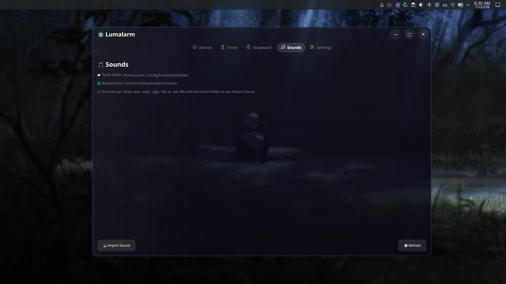

<div align="center">


**Lumalarm** — a smart alarm clock for Linux that wakes your computer from sleep

rtcwake wake scheduling · alarm editor · timer · stopwatch · sound manager

[](LICENSE)
[](https://www.qt.io/)
[]()
[](https://github.com/shinigami1231111/lumalarm/actions/workflows/ci.yml)
[](https://github.com/shinigami1231111/lumalarm/actions/workflows/lint.yml)

</div>

> [!NOTE]
> **Latest release: [v1.0.5](CHANGELOG.md#105---2026-11-22)** — published on GitHub and in the AUR.
> Secure D-Bus wake helper, English / Arabic / Japanese UI, emoji density control and a frameless window.

## Install on Arch

The AUR package ships the **prebuilt** binary, so no compiler is needed:

```bash
yay -S lumalarm     # or: paru -S lumalarm
```

To install the exact same package directly from GitHub:

```bash
curl -fLO https://github.com/shinigami1231111/lumalarm/releases/download/v1.0.5/lumalarm-1.0.5-1-x86_64.pkg.tar.zst
sudo pacman -U lumalarm-1.0.5-1-x86_64.pkg.tar.zst
```

Runtime dependencies: `qt6-base`, `qt6-multimedia`, `qt6-declarative`, `util-linux`.
`pacman -U` (directly or through your AUR helper) installs the systemd unit, D-Bus policy and
polkit action for the wake helper. No `/etc/sudoers.d` rule is used or required.

## Features

- **Wakes a sleeping PC** — a privileged D-Bus helper programs the RTC with `rtcwake`, then the machine wakes just before the alarm fires
- **Alarms & ringing overlay** — per-day schedules, names, auto-stop, optional shell command, and a **Stop** button
- **Timer, stopwatch, sound manager** — laps, completion sound, import/preview of `wav`/`mp3`/`ogg`/`flac`/`aac`
- **Volume policy** — raise the sink while ringing and restore it afterwards, or leave system volume alone
- **Test alarm** — arm a real wake 60 s to 1 h ahead to prove the machine actually wakes
- **Tray, notifications, night mode** — next alarm in the tray tooltip, freedesktop notifications, pre-alarm dimming
- **First-run wizard** — four skippable steps (language, wake method, notifications, summary); reopen with `--show-wizard`
- **English, Arabic & Japanese** — RTL mirroring for Arabic; live language switching
- **Emoji density** — Off / Less / More
- **Themable frameless window** — color pickers, presets, pywal import, true transparency; drag to move, edges to resize

<details>
<summary>Screenshots</summary>

| | | |
|---|---|---|
|  |  |  |
|  |  |  |

</details>

## Build from source

```bash
git clone https://github.com/shinigami1231111/lumalarm.git
cd lumalarm
cmake -B build -DCMAKE_BUILD_TYPE=Release
JOBS=$(( $(nproc) * 80 / 100 )); [ "$JOBS" -lt 1 ] && JOBS=1
cmake --build build -j"$JOBS"
ctest --test-dir build --output-on-failure
./build/lumalarm
```

Requires Qt 6.5+, CMake 3.21+, a C++17 compiler and `util-linux`. KF6WindowSystem (KWin blur)
and Qt Linguist tools are optional. The local mirror of CI is `bash scripts/ci-local.sh`.
See [CONTRIBUTING.md](CONTRIBUTING.md) for the CI matrix and translation workflow.

## Configuration

App data lives in `~/.config/lumalarm/`:

| File | Purpose |
|---|---|
| `theme.conf` | Colors, blur mode, font, corner radius, window buttons — live-reloaded |
| `settings.ini` | Wake mode, time picker, emoji level, language, audio policy, tray/close/night mode, opacity |
| `alarms.json` / `scheduler.json` | Alarms and wake state |
| `tones/` | Imported alarm sounds |

Background opacity is `theme/opacity` in `settings.ini` (0.0–1.0, default `0.55`).
Presets: Catppuccin Mocha, Nord, Gruvbox Dark, Rose Pine, Tokyo Night. On Hyprland add
`windowrulev2 = blur, class:^(lumalarm)$`; on KDE Plasma enable Desktop Effects → Blur and
install `kwindowsystem` before building with blur support.

## Wake helper

The app calls the root-owned `org.lumalarm.Helper` D-Bus service. The helper validates the
delay (`60 <= seconds <= 86400`) and mode, then runs a detached `rtcwake -m <mode> -s <N>`
with an explicit argument list — no shell and no privileged shell rule. Authorization uses
the polkit action `org.lumalarm.schedule.wake`. Modes: `freeze`, `standby`, `mem`, `disk`,
`off`, `no`, `on`. If scheduling fails:

```bash
journalctl -u lumalarm-wake-helper
```

## Contributing / changelog / license

Contributions are welcome — see [CONTRIBUTING.md](CONTRIBUTING.md).
Release history is in [CHANGELOG.md](CHANGELOG.md).
Licensed under the **GNU General Public License v3.0** — see [LICENSE](LICENSE).
